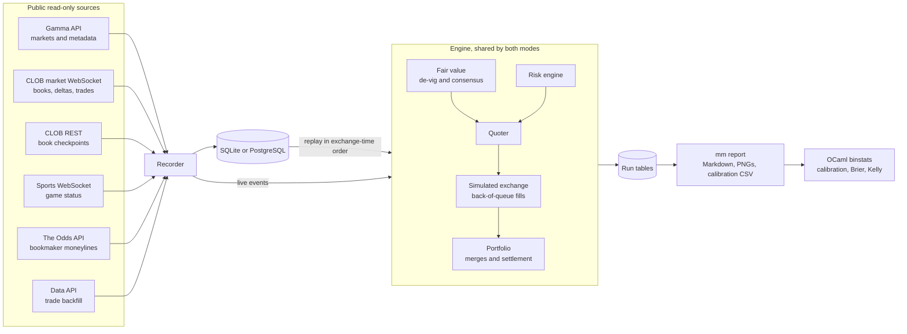

# tickbook

A 2026 research rebuild of a pre-game sports market-making strategy run on Polymarket from 2024 to 2026. Everything here is written fresh. It records Polymarket's NBA and NHL moneyline order books, prices each game from de-vigged bookmaker odds, and simulates a two-sided market maker on that real data, in backtest and live paper-trading modes. It is paper-trading only: there is no order client, no wallet and no key anywhere in the code, and a test fails the build if one is added.

> **Status: the code is complete and has been run against Polymarket's live public APIs; no data has been kept and there are no results yet.**
> On 16 November 2026 discovery, the recorder, replay verification, backtest, paper mode and the report were smoke-tested on live NBA and NHL markets, and the models were corrected where the live data differed (see [`docs/DESIGN.md`](docs/DESIGN.md)). Those short recordings were discarded. The Odds API side has not run at all, because there is no key yet, so nothing has ever been priced or quoted on real odds. The sections marked "none yet" below are filled in only from recorded data, never by hand.

## Ground rules

1. **Nothing made up.** Every number in a result, chart or this README comes from data the system downloaded or recorded. If a source is down or missing, the run fails loudly.
2. **Synthetic data only in tests**, under `tests/fixtures/`, with `synthetic` in the file name.
3. **No personal account data. Although use code as you'd like privately** No wallet address, profile name or trade history of any personal account.
4. **No raw data in Git.** Downloaded trades include other users' wallet addresses; `data/` is git-ignored, wallet fields are never written to the database, and only aggregated results are committed.
5. **No backdating.** Commits carry their real dates.
6. **No original live code.** Nothing is copied from the strategy's live implementation.
7. **Secrets in `.env` only**, git-ignored, with a committed `.env.example`.

## Architecture

One pipeline feeds two modes. The recorder is the only component that talks to the outside world, and it only reads public data. The backtester and the paper trader run the same engine (fair value, quoter, risk, simulated exchange, portfolio); they differ only in where events come from.



Design decisions, the wire formats assumed and the run-table layout are in [`docs/DESIGN.md`](docs/DESIGN.md). The specification is [`docs/BUILD_SPEC.md`](docs/BUILD_SPEC.md).

## Quick start

Requires [uv](https://docs.astral.sh/uv/) and Python 3.12.

```bash
uv sync
```

```bash
cp .env.example .env
```

Put your Odds API key in `.env` as `ODDS_API_KEY=`. Without it the recorder still records everything else, but no game can be priced or quoted.

| Command | What it does |
| --- | --- |
| `uv run mm discover` | Lists NBA and NHL moneyline markets from Gamma with start time, both token ids, tick, minimum size and fee schedule, and stores them. |
| `uv run mm record` | Runs the recorder: market and sports WebSockets, a REST book checkpoint every 60 s, odds polls, odds-to-market matching, trade backfill and the gap log. Runs until stopped. |
| `uv run mm status` | Shows whether a recorder is running (last heartbeat), row counts, odds matches waiting for review and the gap log by stream and reason. `--require-live` exits 1 without a recent heartbeat. |
| `uv run mm verify` | Rebuilds every book from the recorded WebSocket data and compares it with the REST checkpoints. Exit code 1 on a mismatch the recorder did not log itself. |
| `uv run mm backtest` | Replays recorded data through every strategy in `config/default.yaml` (`baseline` and `skew`) and prints a comparison. `--strategy NAME`, `--start ISO`, `--end ISO` narrow it. |
| `uv run mm paper --strategy skew` | Runs the same engine on live data with simulated orders and fills and a terminal dashboard. `--no-dashboard` for unattended runs, `--minutes N` to stop after a while. Order latency comes from the last day of recordings, so record first or set `sim.latency_ms`. Paper mode records too, so stop `mm record` on the same database first; a second recorder refuses to start. |
| `uv run mm report` | Writes `reports/<run_id>/report.md` with charts for the newest run of each strategy, plus a comparison table. `--run ID` picks runs. |

Every tunable number lives in `config/default.yaml`, validated by `src/mm/config.py`; unknown keys are errors. `--config PATH` selects another file and `MM_DATABASE_URL` overrides the database.

### Odds matching needs a person

A market is matched to an odds event by league, both team names (through `config/team_aliases.yaml`) and start time. Only exact matches are accepted automatically. Anything else is written to `data/review/odds_matches.csv` and the game is **not quoted** until you set `confirmed` to `yes` on its row; the next run picks that up.

### Long-running recorder

```bash
docker compose up -d --build
```

This starts PostgreSQL and the recorder, both with `restart: always`. It needs `POSTGRES_PASSWORD` (and optionally `ODDS_API_KEY`) in `.env`. The full procedure for a server, including how to check on it, confirm odds matches and run backtests against its database, is in [`docs/DEPLOY.md`](docs/DEPLOY.md).

### Calibration with the OCaml library

`mm report` writes `calibration.csv` (fair value at each fill and whether YES won). If `binstats` has been built, the report embeds its calibration table:

```bash
cd ocaml/binstats && dune build && dune test
```

```bash
./ocaml/binstats/_build/default/bin/main.exe --bins 10 reports/<run_id>/calibration.csv
```

## Data sources

| Source | Used for | History |
| --- | --- | --- |
| [Gamma API](https://docs.polymarket.com/market-data/discover-markets.md) `gamma-api.polymarket.com` | League tags and home/away ordering, markets, tick, minimum size, fee schedule, reward spread and size | Closed markets queryable |
| [CLOB REST](https://docs.polymarket.com/market-data/prices-order-books.md) `clob.polymarket.com` | Book checkpoints (`POST /books`), per-market reward pool | Current only |
| [CLOB market WebSocket](https://docs.polymarket.com/market-data/realtime-data.md) | Books, price-level deltas, trades, tick changes, resolutions | Live only |
| [Sports WebSocket](https://docs.polymarket.com/market-data/realtime-data.md) | Game status | Live only |
| [Data API v2](https://data-api.polymarket.com/v2/openapi.json) | Per-market trade backfill after resolution | Full |
| [The Odds API v4](https://the-odds-api.com/liveapi/guides/v4/) | Bookmaker moneylines (`us` and `eu` regions; Pinnacle is in `eu`) | Paid plans only |
| [Geoblock check](https://docs.polymarket.com/api-reference/geoblock.md) | Logged at recorder start | n/a |

Polymarket publishes no historical order books, so a backtest can only cover dates this recorder was running.

**Data window recorded: none yet.**

## Results

**None yet.** No data has been recorded, so there is no PnL attribution table, markout chart, cumulative PnL chart, risk-event summary or calibration table to show. `mm report` produces all of them from the database, each stamped with its run id, data window and config hash, and they belong here only once they come from real recordings. `reports/` is empty for the same reason.

## What needs the owner

These cannot be done by code:

- [ ] **Odds API key** in `.env`, then `uv run pytest -m integration` once to check the Odds API models against real responses (those two tests skip without a key). Budget: with the default two regions and two snapshots per game, the current NBA and NHL calendar needs roughly 30 credits a day, about 900 a month, so the free 500 run out after about two weeks. Either set `odds.regions: [eu]` (Pinnacle only, about 450 a month), take one snapshot per game, or buy the US$30 tier. Historical odds for recorded dates are a further paid option.
- [ ] **Check `config/team_aliases.yaml` against the bookmaker side.** Every Polymarket outcome name seen live resolves through it; the names The Odds API uses have not been checked against real responses. Watch the review file after the first odds poll.
- [ ] **72-hour unattended recorder run**, then `mm verify` and a look at the gap log.
- [ ] **At least 4 weeks of continuous NBA and NHL recordings**, on a small AWS instance with `docker compose up -d` and NTP running, with the gap summary published.
- [ ] **Backtest `baseline` and `skew` on that data** and commit the reports and comparison table.
- [ ] **One full NBA night in paper mode** (`mm paper`), compared with a backtest of the same night, with any gap explained.
- [ ] **Run `gitleaks` over the history** before publishing (CI already runs it on every push).
- [ ] Put the resulting tables and charts in this README, each with its run id.

## What is unverified

Checked live on 16 November 2026: Gamma `/sports` and `/markets`, CLOB `/book` and `POST /books`, the market WebSocket (`book`, `price_change`, `last_trade_price`, `best_bid_ask`, `new_market`), the sports WebSocket, Data API v2 `/trades` with cursor paging, the per-market rewards endpoint, the geoblock endpoint and the published rate limits. Not yet checked:

- **The Odds API**: client, polling schedule, credit handling and the odds-to-market matcher have only run against synthetic payloads written from its documentation.
- `tick_size_change`, `market_resolved` and NBA or NHL frames on the sports feed did not occur during the live sessions.
- Nothing has run for longer than a few minutes, and the Docker Compose stack has only been built and tested in CI, not run against live data.

A response that does not match its model fails validation with the raw payload saved under `data/failed_payloads/`; nothing is guessed around. The full list is in [`docs/DESIGN.md`](docs/DESIGN.md).

## Limitations

- **Queue position is an assumption.** A simulated order joins the back of its price level, behind the size displayed when it becomes live. Only recorded trades at its price move it forward; cancels ahead of it never do. A trade through its price fills it up to the trade's size, and by default a book that moves through it fills it in full. This is deliberately conservative and still a model: real queue position is unobservable from public data.
- **Odds are snapshots.** Fair value only changes when an odds poll lands. Between polls the engine quotes around a stale price, and on the free tier polls are hours apart. Odds older than `fairvalue.max_odds_age_minutes` are dropped and the game stops quoting.
- **Rewards and rebates are estimates.** Liquidity rewards use the published scoring formula sampled once a minute and treat the whole recorded book as one competing maker; they are reported beside PnL and never inside it. Maker rebates use the market's published rebate rate on the taker fee the fill would have generated.
- **No live execution.** Latency is a single measured or configured number added to every order action. There is no partial-fill priority beyond the queue model, no self-impact on the book, and no adverse reaction of other makers to the simulated quotes.
- **The stream is not perfectly complete.** In live sessions Polymarket's market feed occasionally never delivered a level change (a few times per five minutes across 542 tokens). The recorder detects each one at the next REST checkpoint, logs it as a `lost_update` gap and repairs the book; until then (at most a minute) one level's size is wrong. `mm verify` reports them and fails only on one the recorder did not log.
- **Trades come from one feed.** The feed reports each fill once, on the taker's token; NO-token trades are mirrored into YES space (`sim.trade_assets: both`).
- **Rewards are currently zero for these markets.** Game moneylines had no reward pool configured when checked, so the estimate is 0 until Polymarket configures one.
- **Gaps are excluded, not repaired.** While a recorder gap is open the affected markets do not quote, and the excluded time is reported.
- If a result ever looks too good, re-run the no-lookahead and fill-model tests before believing it.

## Development

```bash
uv run ruff format .
```

```bash
uv run ruff check .
```

```bash
uv run mypy
```

```bash
uv run pytest --cov=mm --cov-fail-under=85
```

CI runs those on every push, the same suite again on PostgreSQL (set `MM_TEST_DATABASE_URL` to do that locally), plus `dune test` for `ocaml/binstats`, a Docker image build and `gitleaks`. Integration tests that touch the network are marked `integration`, excluded from the default run and executed nightly.

The test suite covers: de-vig methods and edge cases; book rebuild including removed levels and out-of-order messages; a hand-worked 10-order fill fixture; the fee formula against Polymarket's worked example; reward scoring; every risk rule breached and not breached; merge and settlement arithmetic; property tests for the cash identity, quote validity and non-negative inventory; no-lookahead with poisoned future data; byte-identical reruns and reports; replay accuracy; report provenance; and the safety test that fails if an order-signing or wallet library is installed or imported.

## Layout

```
config/          default.yaml (every tunable number), team_aliases.yaml
src/mm/
  discovery/     Gamma client and market discovery
  recorder/      WebSocket feeds, REST checkpoints, odds poller, backfill, writer, gap log
  storage/       schema and read/write helpers
  fairvalue/     de-vig, consensus, odds-to-market matching
  strategy/      quoter: baseline spread and inventory skew
  risk/          loss cap, exposure limit, loss throttle, stale-data kill switch
  inventory/     positions, merges, settlement
  sim/           simulated exchange, fees, rewards, replay, backtest
  engine.py      the trading loop shared by backtest and paper mode
  paper/         live paper trading and dashboard
  analytics/     attribution, markouts, charts, report, replay check
  cli.py         mm discover | record | status | verify | backtest | paper | report
ocaml/binstats/  calibration, Brier score, Kelly sizing; CSV CLI
tests/           unit, integration (nightly), fixtures (synthetic only)
reports/         committed: aggregated results and charts only (empty until data exists)
data/            git-ignored: database, raw payloads, review file
```
